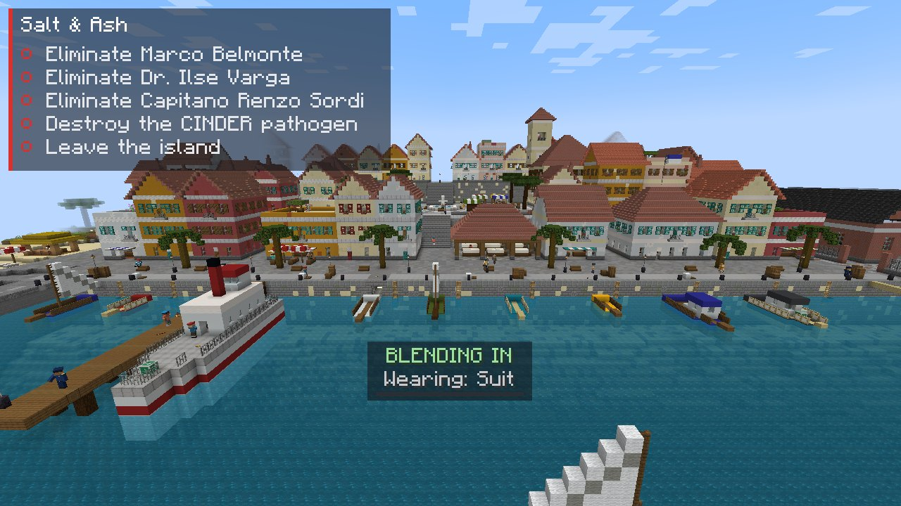
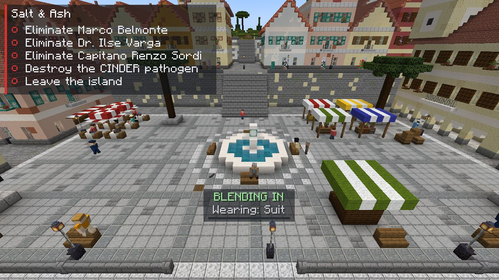
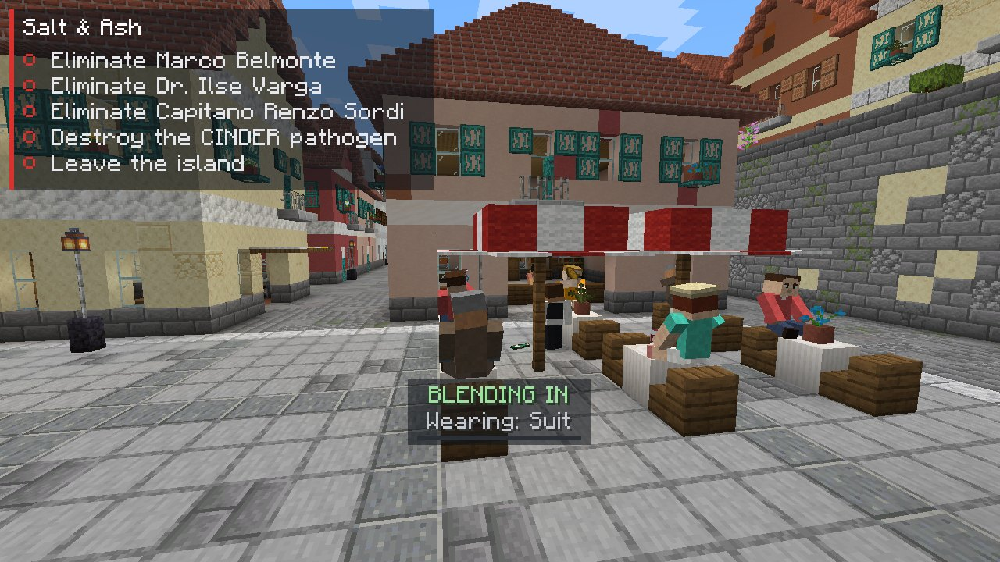
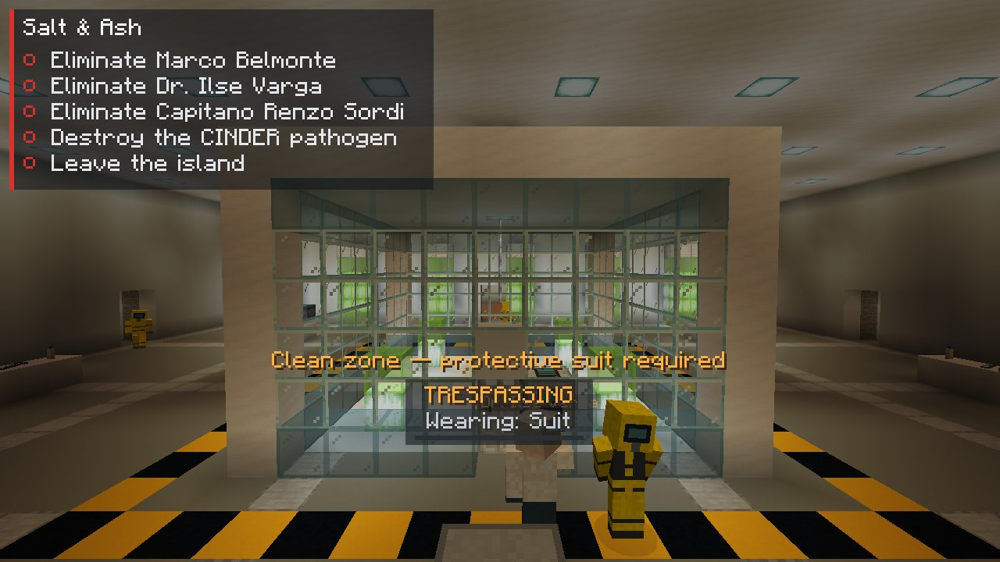
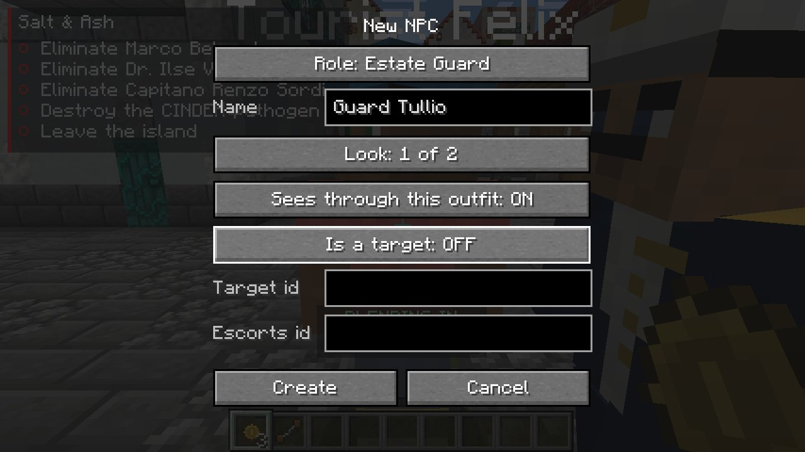

# Recrafted: Contracts

A stealth-sandbox mod for **Minecraft 1.20.1 (Forge 47+)**: one hand-built island, three contracts, a
town full of people who follow routines you can edit, and dozens of props to pick up and misuse.

The mission, **Salt & Ash**, takes place in **Corvara** — an original sun-bleached harbour town on a
limestone island. The setting, layout, characters and story are this project's own.



| | |
|---|---|
|  |  |
|  |  |
|  |  |

All screenshots are taken in-game by the automated tour (`./gradlew runClient -Pclienttest`).

## What is in the box

| | |
|---|---|
| **The island** | 320 × 288 blocks, generated by `tools/mapgen` and served to the game by a custom chunk generator in its own dimension (`recrafted:corvara`). Harbour and quay with moored boats, ferry pier, breakwater and lighthouse, fish market, harbour office, three terraces of stuccoed townhouses, Piazza del Sale with café and market, town hall with clock tower, chapel and cemetery, olive grove, the Tenuta Belmonte wine estate (villa, court, tower, pool, vineyards, cellar), and the cannery. |
| **Underground** | A sewer and cistern under the piazza, the old salt mine, and the Halcyon lab: security corridor, locker room, canteen, airlock, the core hall with its containment chamber, wet lab, cold store, server room, greenhouse — plus a sea cave with a private dock. |
| **The cast** | 131 NPCs across 20 roles (civilians, tourists, fishermen, shopkeepers, waiters, cooks, cleaners, gardeners, a priest, cannery workers, harbour police, estate guards, bodyguards, Halcyon security, virus-lab guards, scientists, hazmat technicians and the three targets). Every one has a hand-placed route. |
| **Props** | 39 usable props and 14 outfits lying around the map. |
| **Tools** | The **Route Planner** and the **Casting Card** for building your own cast and routes on this map or any other. |

## Playing the contract

1. Install Forge 47.x for 1.20.1 and drop the mod jar in `mods/`.
2. Create a world (any type) and run **`/contract start`**. You arrive on the evening ferry.
3. Eliminate **Marco Belmonte**, **Dr. Ilse Varga** and **Capitano Renzo Sordi**, destroy the CINDER
   sample in the lab, and leave by an exit point (the ferry, the patrol launch, or the boat in the sea cave).

`/contract intel` lists what your handler knows. `/contract status` shows objectives.
Hold **V** (Focus) to outline targets (red), guards (blue) and anyone who can see through your outfit (white).

### How the town reacts

- **Suspicion** builds while someone watches you trespass, carry something illegal in the open, or — for
  NPCs marked with a white dot — wear *their* uniform up close. The bar above the hotbar shows the worst case.
- **Crimes** have witnesses. Civilians run and call for help; guards attack and pull in other guards.
  Break line of sight for a while and they search, then go back to their routines.
- **Bodies** get found. A guard who finds an unconscious colleague wakes them; a dead one triggers a sweep.
  Sneak + right-click a body to drag it, and right-click a green **hiding crate** to stash it.
- **Outfits** come from a body (right-click it) or from folded uniforms lying around. Each restricted zone
  accepts a set of outfits; the HUD tells you when you are trespassing.
- **Poison** a plate or a glass with a vial. Whoever's route has them eat or drink there takes it:
  emetics send them somewhere private, lethal doses look like bad luck.
- **Noise** moves people. Thrown coins, broken bottles, a pocket radio, or a sabotaged fuse box
  (wrench or screwdriver) all pull someone off their post.
- **Security doors** open to the matching keycard, quietly to a lockpick, loudly to a crowbar.
  Staff with clearance walk through on their own.

### Props

| Kind | Items | Use |
|---|---|---|
| Blunt | wrench, crowbar, hammer, lead pipe, brick, bottle, frying pan, rolling pin, fish, oar, shovel, golf club, broom, baton, candlestick, fire extinguisher | Left-click to knock out. Most can be thrown (right-click). |
| Sharp | kitchen knife, cleaver, scissors, letter opener, screwdriver, garden shears, fire axe, fishing gaff, corkscrew, scalpel | Left-click: lethal. Several can be thrown. |
| Silent | fiber wire, sedative syringe, lethal syringe | From behind only. |
| Distraction | coin, pocket radio | Throw. |
| Chemistry | emetic vial, rat poison, lethal poison vial | Right-click a plate or glass. |
| Access | lockpick, lab / estate / harbour keycards | Right-click a card reader. |
| Outfits | 14 uniforms | Right-click to change. |

Bare hands subdue from behind.

## Directing the cast

Both tools need creative mode or operator rights. `/contract tools` hands them to you.

**Casting Card**
- Right-click a block → *New NPC*: pick the role, name and look, whether it is a target, whether it sees
  through its own uniform, and (optionally) an id that an escort can follow.
- Right-click an NPC → edit it, or remove it.

**Route Planner**
- Right-click an NPC to select it (it glows, and its route is drawn in the world).
- Right-click blocks to drop stops, in order. Each stop remembers the direction you were facing.
- Left-click a stop to remove it.
- Sneak + right-click to open the **route editor**:
  - *Stay* — how long the NPC waits there (0 = walk straight through).
  - *Does* — one of 18 poses: stand, stand guard, sit, lean, phone, smoke, drink, eat, work, sweep, type,
    talk, look around, wave, crouch, lie down, dance, pray.
  - *Arrives* — walking or running.
  - *Faces* — the direction to face while waiting.
  - *Says* — a line shown above the NPC's head on arrival.
  - Reorder, copy, delete, move a stop to where you stand.
  - Route repeat mode (loop / back and forth / once), pause the NPC while you work, and **Test route**.

Seats work by placing a stop on a stair or slab and choosing *Sit* (or eat/drink).
NPCs told to eat or drink use the nearest plate or glass — which is how poisoning finds its victim.

**Saving your work**

- `/contract cast export` writes the whole current cast to `config/recrafted/corvara.cast.json`.
  From then on `/contract start` uses it instead of the built-in cast.
- `/contract cast reset` goes back to the built-in cast.
- NPCs you create outside the Corvara dimension are ordinary persistent entities, so the tools work on
  any map you like.

Other commands: `/contract visit` (go to the island without starting), `/contract freeze <true|false>`,
`/contract disguise <role|none>`, `/contract stop`.

### The editors

| Route editor | NPC editor |
|---|---|
|  |  |

## Good to know

- Minecraft shows its *experimental settings* prompt the first time a world with the mod is opened,
  because the island is a custom dimension. Forge remembers the answer per world.
- The island is generated once per world. After updating the mod to a version with a changed map, delete
  `dimensions/recrafted` inside the world folder and the island regenerates on the next visit.
- `/contract start` puts survival players in adventure mode so the set stays intact. Creative players are
  ignored by the NPCs, which is what you want while editing routes.
- NPCs walk through each other rather than shoving. That is deliberate: it keeps narrow alleys, piers and
  doorways from jamming.
- Guards are melee-only until the TACZ add-on lands.

## Building

```
./gradlew build                       # jar in build/libs
./gradlew runClient                   # dev client
./gradlew runServer -Pselftest        # headless smoke test: loads the island, runs the cast, checks objectives
./gradlew runClient -Pclienttest       # screenshot tour of a world named corvara_test (needs a display or xvfb-run)
python3 tools/mapgen/build.py         # regenerate the island + mission data (+ previews in docs/preview)
python3 tools/assets/gen_assets.py    # regenerate textures, models and the language file
```

The map lives in `src/main/resources/data/recrafted/maps/corvara.rcmap` (gzip: palette of block-state
strings + a dense `uint16` grid). `tools/mapgen` is plain Python with numpy and Pillow:
`terrain.py` shapes the island, `town.py` builds the houses and piazza, `landmarks.py`, `estate.py` and
`lab.py` add the set pieces, and `mission.py` writes the cast, props, zones and objectives using anchors
recorded while building — so routes stay valid when geometry moves.
`walkcheck.py` then walks every route leg on the voxel grid, reports anything unreachable, and splits long
legs into short hops so the in-game pathfinder never has to solve a hard path.

## How it was tested

Nothing here was checked by eye alone. Two harnesses ship with the mod (`recrafted.dev`):

- **Server self-test** (`runServer -Pselftest`): boots a dedicated server, generates the island, queues the
  whole cast, simulates two minutes and reports arrivals and stuck NPCs, then completes every objective.
- **Client tour** (`runClient -Pclienttest`): opens a world, starts the contract, takes the screenshots above,
  then plays a scripted run with the real player on the integrated server and asserts each mechanic:
  subdue from behind · take the outfit · disguise grants access · trespass raises suspicion ·
  poisoned meal kills · drag and hide a body · keycard opens a security door · fuse-box sabotage lures a
  repairer · thrown coin distracts · purge destroys the sample · all three targets eliminated · exit
  completes the contract.

| | |
|---|---|
|  |  |

Not covered by automation: multiplayer with several real players, and playing the mission by hand from start
to finish. Guards hit hard, and balance (suspicion rates, vision ranges) has only been tuned by reasoning.

The headless self-test currently reports, for two minutes of simulated town life with all 131 NPCs:
703 waypoint arrivals and 0 NPCs stuck.

## Roadmap

- Firearms through a **TACZ** add-on (guards are melee-only for now).
- More accident kills, more exits, a second mission.

## Licence

MIT.
