# Recrafted: Contracts

A stealth-sandbox mod for **Minecraft 1.20.1 (Forge 47+)**: two hand-built maps, each with three targets,
towns full of people who follow routines you can edit, and dozens of props to pick up and misuse.

- **Salt & Ash** takes place in **Corvara**, an original sun-bleached harbour town on a limestone island.
- **Oil & Water** takes place in **Amsterdam** at blue hour in the drizzle: canals, gabled houses, an
  auction house, a forger's attic and a smuggler's boat (see [Oil & Water](#the-second-contract-oil--water)).

The settings, layouts, characters and stories are this project's own.

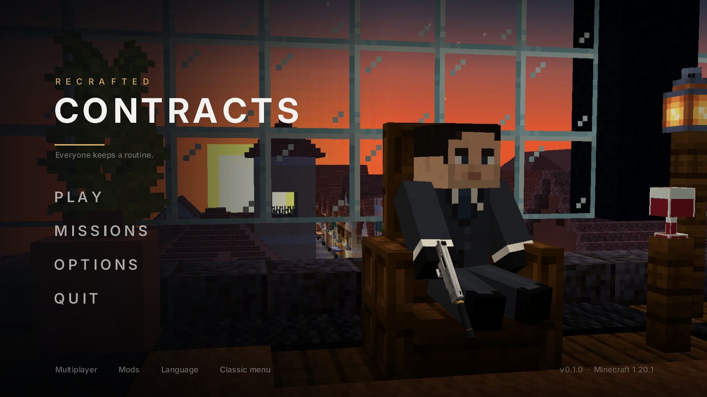


| | |
|---|---|
|  |  |
| 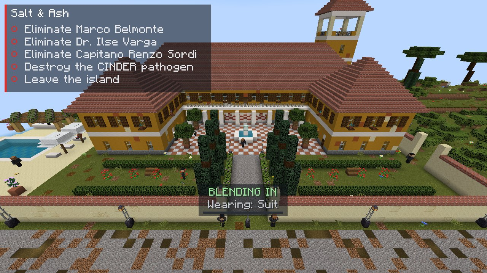 | 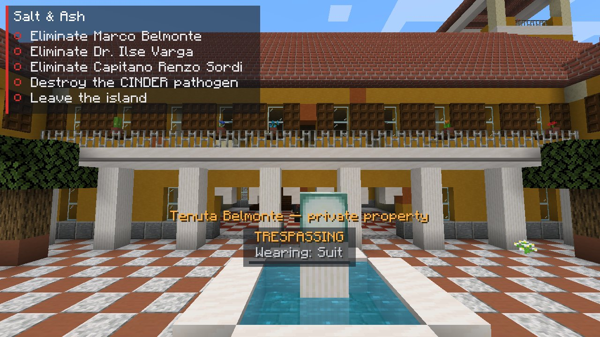 |
|  | 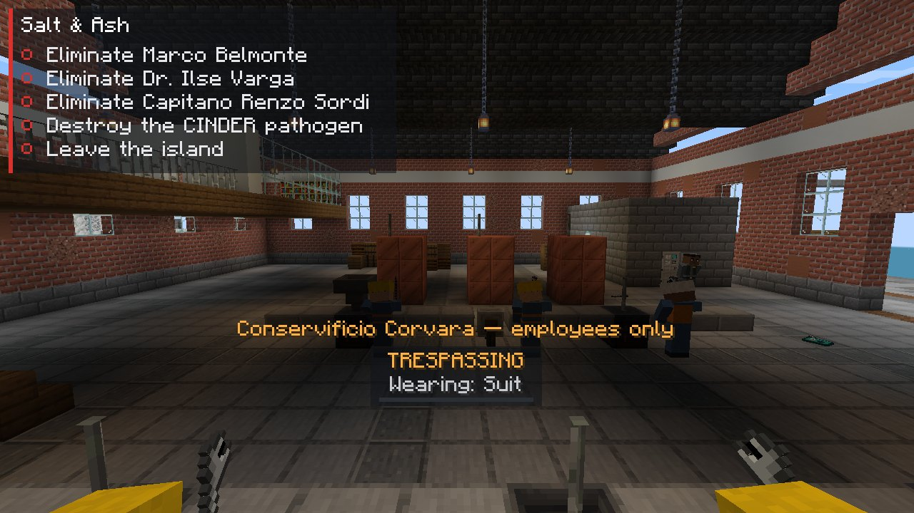 |

All screenshots are taken in-game by the automated tour (`./gradlew runClient -Pclienttest`).

## What is in the box

| | |
|---|---|
| **The island** | 320 × 288 blocks, generated by `tools/mapgen` and served to the game by a custom chunk generator in its own dimension (`recrafted:corvara`). Harbour and quay with moored boats, ferry pier, breakwater and lighthouse, fish market, harbour office, three terraces of stuccoed townhouses, Piazza del Sale with café and market, town hall with clock tower, chapel and cemetery, olive grove, the Tenuta Belmonte wine estate (villa, court, tower, pool, vineyards, cellar), and the cannery. |
| **Underground** | A sewer and cistern under the piazza, the old salt mine, and the Halcyon lab: security corridor, locker room, canteen, airlock, the core hall with its containment chamber, wet lab, cold store, server room, greenhouse — plus a sea cave with a private dock. |
| **The cast** | 131 NPCs across 20 roles (civilians, tourists, fishermen, shopkeepers, waiters, cooks, cleaners, gardeners, a priest, cannery workers, harbour police, estate guards, bodyguards, Halcyon security, virus-lab guards, scientists, hazmat technicians and the three targets). Every one has a hand-placed route. |
| **Props** | 39 usable props and 14 outfits lying around the map. |
| **Tools** | The **Route Planner** and the **Casting Card** for building your own cast and routes on this map or any other. |

## The title screen

The mod replaces Minecraft's title screen with its own: an operative waits in a penthouse over Corvara at dusk,
with **Play** (the normal Singleplayer screen: load a world or create a new one), **Missions**, **Options** and **Quit** down the side, and small links to
Multiplayer, Mods, Language and the classic menu at the bottom.

**Missions** is the contract browser: a slow flyover of the island, the briefing, the three targets with their
faces, and **Play mission**, which opens a world called *Recrafted Contracts* (creating it the first time) and
starts the contract as soon as you arrive.

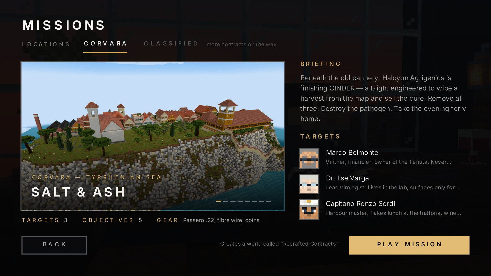

The background and the flyover frames are real in-game renders, made by `./gradlew runClient -Pmenushots=scene,orbit`
(builds the penthouse next to the island, seats the operative, photographs it at dusk, circles the island, then
puts every block back) and processed by `tools/assets/menu_images.py`. The menu text is set in Inter
(SIL Open Font License; subsets in `assets/recrafted/font`, made by `tools/assets/fonts.py`).

## Playing the contract

1. Install Forge 47.x for 1.20.1 and drop the mod jar in `mods/`.
2. Pick **Missions → Play mission** on the title screen, or create any world yourself and run **`/contract start`**. You arrive on the evening ferry with three coins,
   the fiber wire and (with TACZ and the gun pack) a loaded **Passero .22** plus two spare magazines. It's legal
   while it stays in your inventory; in your hand it's a gun like any other.
3. Eliminate **Marco Belmonte**, **Dr. Ilse Varga** and **Capitano Renzo Sordi**, destroy the CINDER
   sample in the lab, and leave by an exit point (the ferry, the patrol launch, or the boat in the sea cave).

`/contract intel` lists what your handler knows. `/contract status` shows objectives.
Hold **V** (Focus) to outline targets (red), guards (blue) and anyone who can see through your outfit (white).
Press **X** to throw what you are holding: props, and guns too.
The **Cicala Case** is a briefcase, legal to carry anywhere. Hold use on it for a couple of seconds to assemble
the sniper rifle inside (anyone watching gets suspicious); with the rifle in hand press **B** to pack it away again.
The case keeps the rifle's rounds and scope. A new case also holds two spare magazines. Craft one from leather,
iron and a gold ingot (needs TACZ and the gun pack).

### How the town reacts

- **Suspicion** builds while someone watches you trespass, carry something illegal in the open, or — for
  NPCs marked with a white dot — wear *their* uniform up close. The bar above the hotbar shows the worst case.
- **Crimes** have witnesses. Civilians run and call for help; guards attack and pull in other guards.
  Break line of sight for a while and they search, then go back to their routines.
- **Finishing** someone who is out cold: attack the body with a blade or the fiber wire, use a lethal syringe
  on it, or sneak + attack with empty hands. An unconscious body left in water, in fire or dropped from a
  height dies as an accident.
- **Bodies** get found. A guard who finds an unconscious colleague wakes them; a dead one triggers a sweep.
  Sneak + right-click a body to drag it, and right-click a green **hiding crate** to stash it.
- **Outfits** come from a body (right-click it) or from folded uniforms lying around. Each restricted zone
  accepts a set of outfits; the HUD tells you when you are trespassing.
- **Poison** a plate or a glass with a vial. Whoever's route has them eat or drink there takes it:
  emetics send them somewhere private, lethal doses look like bad luck.
- **Noise** moves people. Thrown coins, broken bottles, a pocket radio, or a sabotaged fuse box
  (wrench or screwdriver) all pull someone off their post.
- **Guns** (with [TACZ](https://modrinth.com/mod/timeless-and-classics-zero) and the Recrafted Arsenal gun pack,
  see [gunpack/README.md](gunpack/README.md)). Guards carry a gun: estate guards a **Lupara** sawn-off slung on
  the back, bodyguards a **Vento .357** revolver, lab guards a **Halcyon PDW** and Halcyon security a **Bulwark AR** (both slung),
  harbour police a **Bastone 9**,
  and Capitano Sordi his engraved **Argento .45**, holstered on the hip. Knock a guard out or kill them and the gun drops beside the body, loaded, with a
  spare reload that you pick up with it (right-click). Dropped guns are cleared when the contract restarts.
  A gun in your hand is illegal unless you wear a guard uniform. A shot compromises you to anyone who sees it,
  and the nearest people in earshot (guards first) come to look; suppressed guns are heard from much closer.
  A thrown gun knocks out whoever it hits, then lies where it lands for you to pick up again.
- **Armed guards shoot back.** Once a guard is in a fight they draw their sidearm, take a two-handed aim and,
  after a moment to react, open fire: single shots from a revolver, short strings from a Bastone, a pause to
  reload when empty, a pistol-whip if you get close; the PDW goes in short automatic bursts, the rifle
  in controlled pairs and triples. Inside about
  15 blocks (8 with a shotgun, 13 with the PDW, 18 with the rifle) they hold position and shoot; further out they close in. They miss more at range and against a running target, their bullets do a quarter
  of the gun's damage to you, and they never hit each other or bystanders. Guards without a gun (or once
  they've dropped it) still come at you with a baton.
- **Security doors** open to the matching keycard, quietly to a lockpick, loudly to a crowbar. Right-click
  either the door itself or the card reader beside it.
  Staff with clearance walk through on their own.

### Props

| Kind | Items | Use |
|---|---|---|
| Blunt | wrench, crowbar, hammer, lead pipe, brick, bottle, frying pan, rolling pin, fish, oar, shovel, golf club, broom, baton, candlestick, fire extinguisher | Left-click to knock out. Most can be thrown (right-click or **X**). |
| Sharp | kitchen knife, cleaver, scissors, letter opener, screwdriver, garden shears, fire axe, fishing gaff, corkscrew, scalpel | Left-click: lethal. Several can be thrown. |
| Silent | fiber wire, sedative syringe, lethal syringe | From behind only. |
| Distraction | coin, pocket radio | Throw. |
| Chemistry | emetic vial, rat poison, lethal poison vial | Right-click a plate or glass. |
| Access | lockpick, lab / estate / harbour keycards | Right-click a card reader. |
| Outfits | 14 uniforms | Right-click to change. |

Bare hands subdue from behind.

## The second contract: Oil & Water

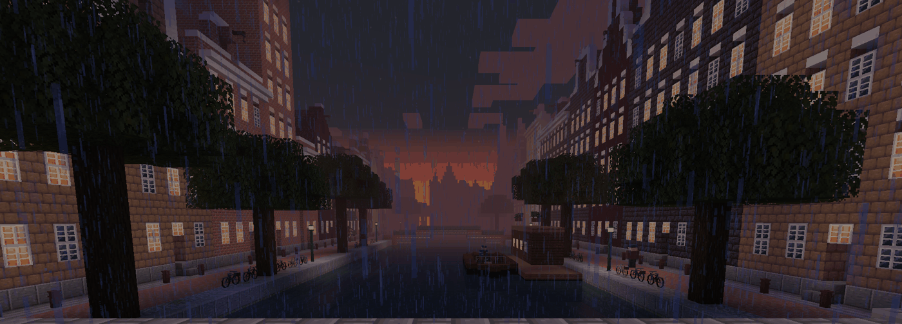

Amsterdam, a little after half past seven on an autumn evening. The money meant for CINDER is being washed
through paint: a forger nobody can name turns out Golden Age masters, an auctioneer sells them to buyers who
don't exist, and a smuggler takes the proceeds out through the canals. Start it from **Missions → Amsterdam**
or with **`/contract start amsterdam`**.

| | |
|---|---|
| 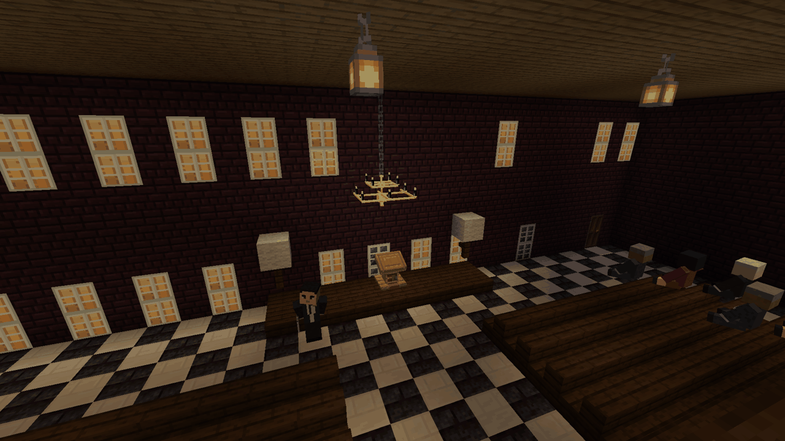 | 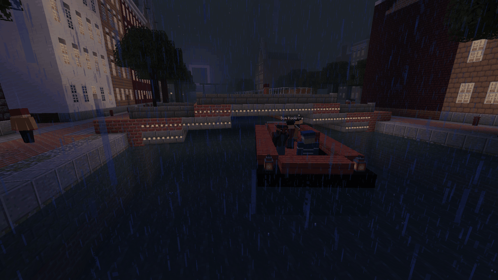 |
| 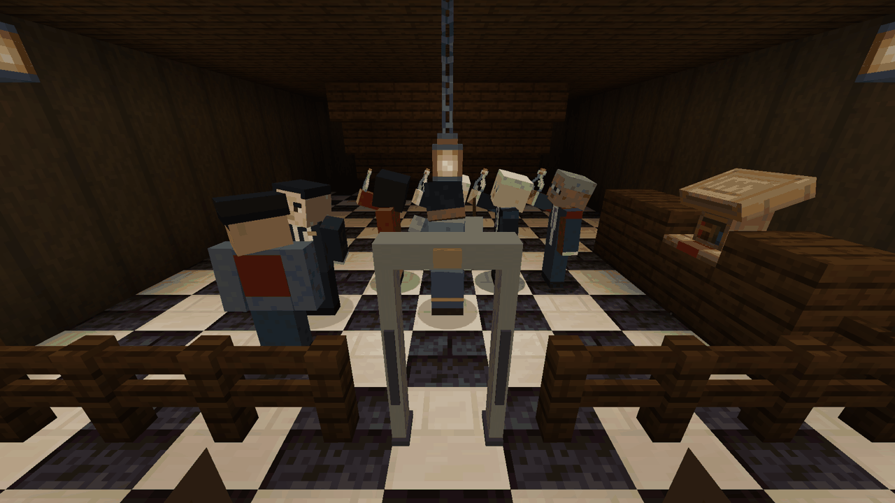 | 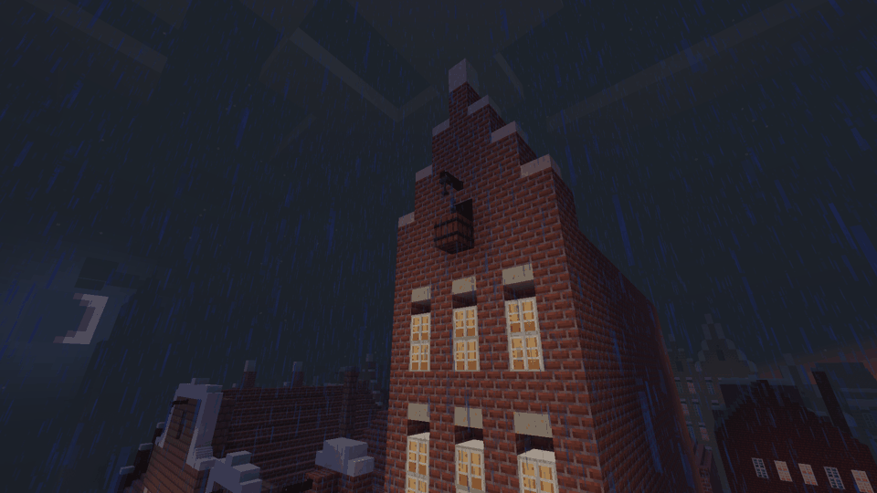 |
| 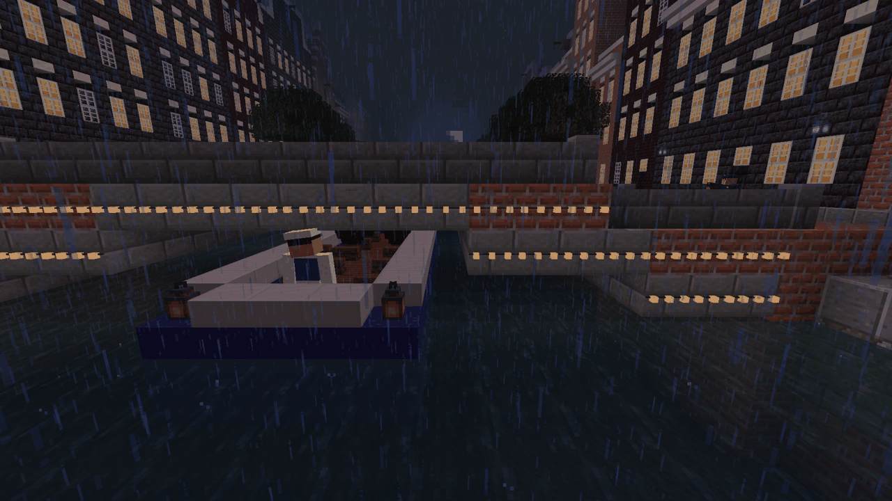 | 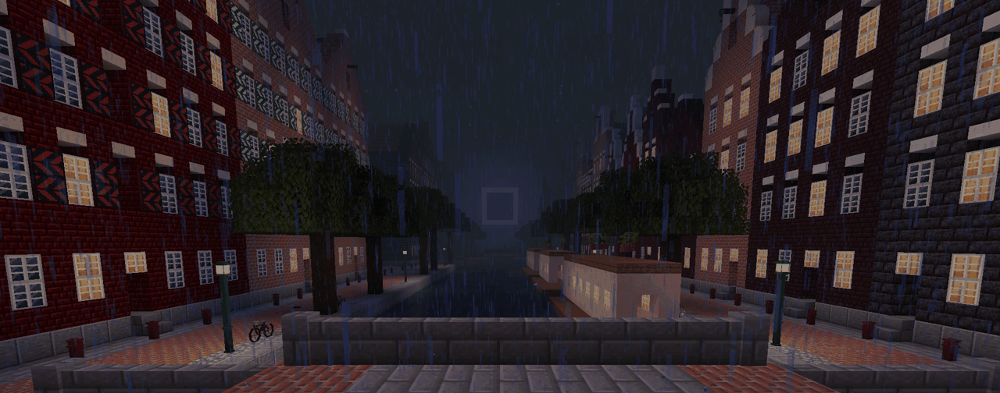 |

**The map** (384 × 320, dimension `recrafted:amsterdam`, generated by `tools/mapgen/amsterdam`): two ring
canals and two cross canals with about 280 gabled houses (spout, step, neck, bell and cornice gables, lit sash
windows, hoist beams), humped brick bridges outlined in bulbs, a white timber drawbridge, a lock with its
keeper's house, houseboats and flower barges, the IJ harbour with warehouses, a ferry and the station, the
Gulden Hamer auction house (saleroom, vault, garden and coach house), a brown café, a church, an almshouse
courtyard, a police post and a flower market. A custom sky, fog and constant drizzle set the mood.

**The targets**, three different problems:

| Target | The problem | Some ways in |
|---|---|---|
| **Margriet Ostendorp**, auctioneer | A crowd, and a schedule. The sale runs from a quarter to the hour until a quarter past, and she holds the podium the whole time, under the chandelier. A metal detector guards the front door. | The chandelier's winch on the press balcony; her champagne in the viewing room; the vault during the interval; staff come in through the garden. |
| **De Meester**, forger | Nobody knows his face. He is one of four apprentices in the attic studio, with no target marker until you identify him. | Read the wage book upstairs in the café, or watch the painters until one gives himself away (he paints left-handed). Then: the crate of lead white on the hoist over the quay, his tea by the window, turpentine on the studio stove. |
| **Sem Kooistra**, smuggler | He moves, by water, and he can't swim. His salon boat, the *Zwaluw*, takes him from his houseboat through the drawbridge to the smuggler's dock and home again through the lock. | Hold the drawbridge down and drop the goods crane's crate on the waiting boat; empty the lock chamber with him at the rail; shove him off a deck with a boat hook; his jenever on the houseboat. |

Optional bonus: recover the Gulden Hamer's ledger from the vault.

**New systems.** A mission clock (shown with the title in the HUD; the carillon chimes the quarters) drives
schedules: NPCs switch routes at set times. Canal boats follow water routes, tie up at moorings, wait for the
drawbridge and the lock, and carry NPCs and players; the bridge keeper's lever and the lock keeper's sluice
wheel are usable (with the keeper's key or uniform). Hidden targets, clue blocks, winches that drop whatever
hangs on a chain, and stoves that can be rigged.

**The cast:** 158 NPCs in 24 roles, 18 of them new (police, auction security, collectors, press photographers,
apprentices, deckhands, skippers, houseboat residents, flower sellers, herring vendors, the bridge keeper and
more), with Corvara's civilians, tourists, waiters, cooks, cleaners and bodyguards dressed for the rain.

**New props:** wooden clog, Gouda wheel, Delft vase and stone jenever bottle (throwable; the last two shatter),
boat hook (shoves people into the water), bike chain lock (a legal garrotte), palette knife, auctioneer's gavel,
umbrella (people who know your face take longer to notice), turpentine, tulip bulbs (emetic), lead white
(lethal), bidder paddle (gets you into the saleroom), bridge keeper's key and press camera (its flash dazzles).

The full design notes are in [docs/missions/amsterdam_plan.md](docs/missions/amsterdam_plan.md).

## Directing the cast

Both tools need creative mode or operator rights. `/contract tools` hands them to you.

**Casting Card**
- Right-click a block → *New NPC*: pick the role, name and look, whether it is a target, whether it sees
  through its own uniform, and (optionally) an id that an escort can follow.
- Right-click an NPC → edit it, or remove it.

**Route Planner**
- Right-click an NPC to select it (it glows, and its route is drawn in the world).
- Right-click blocks to drop stops, in order. Each stop remembers the direction you were facing.
- Left-click a stop to remove it.
- Sneak + right-click to open the **route editor**:
  - *Stay* — how long the NPC waits there (0 = walk straight through).
  - *Does* — one of 18 poses: stand, stand guard, sit, lean, phone, smoke, drink, eat, work, sweep, type,
    talk, look around, wave, crouch, lie down, dance, pray.
  - *Arrives* — walking or running.
  - *Faces* — the direction to face while waiting.
  - *Says* — a line shown above the NPC's head on arrival.
  - Reorder, copy, delete, move a stop to where you stand.
  - Route repeat mode (loop / back and forth / once), pause the NPC while you work, and **Test route**.

Seats work by placing a stop on a stair or slab and choosing *Sit* (or eat/drink).
NPCs told to eat or drink use the nearest plate or glass — which is how poisoning finds its victim.

**Saving your work**

- `/contract cast export` writes the whole current cast to `config/recrafted/corvara.cast.json`.
  From then on `/contract start` uses it instead of the built-in cast.
- `/contract cast reset` goes back to the built-in cast.
- NPCs you create outside the Corvara dimension are ordinary persistent entities, so the tools work on
  any map you like.

Other commands: `/contract visit` (go to the island without starting), `/contract freeze <true|false>`,
`/contract disguise <role|none>`, `/contract stop`.

### The editors

| Route editor | NPC editor |
|---|---|
| 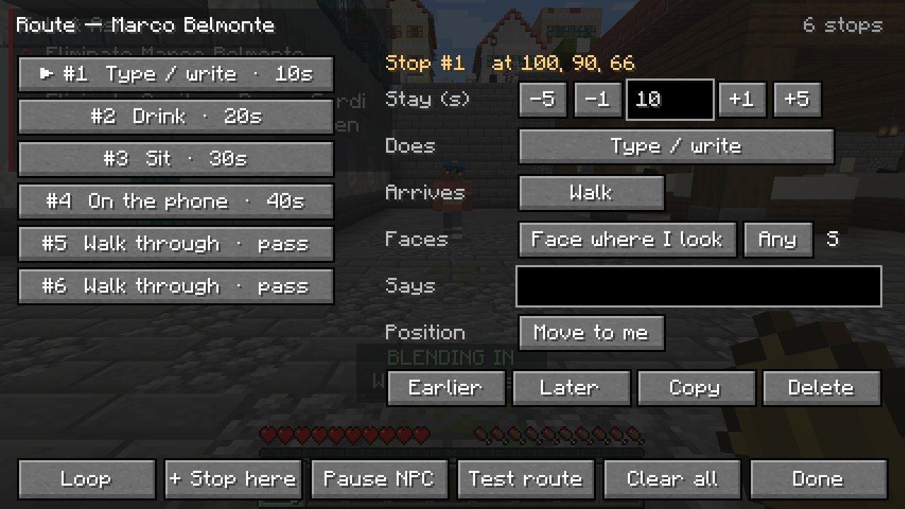 |  |

## Good to know

- Minecraft shows its *experimental settings* prompt the first time a world with the mod is opened,
  because the island is a custom dimension. Forge remembers the answer per world.
- The island is generated once per world. After updating the mod to a version with a changed map, delete
  `dimensions/recrafted` inside the world folder and the island regenerates on the next visit.
- `/contract start` puts survival players in adventure mode so the set stays intact. Creative players are
  ignored by the NPCs, which is what you want while editing routes.
- NPCs walk through each other rather than shoving. That is deliberate: it keeps narrow alleys, piers and
  doorways from jamming.
- Without TACZ, or without the gun pack, guards are simply unarmed; nothing else changes.

## Building

```
./gradlew build                       # jar in build/libs
./gradlew runClient                   # dev client
./gradlew runServer -Pselftest        # headless smoke test: loads the island, runs the cast, checks objectives
./gradlew runClient -Pclienttest       # screenshot tour of a world named corvara_test (needs a display or xvfb-run)
./gradlew runClient -Pmenushots=scene,orbit   # renders the title background and the mission flyover frames
./gradlew runClient -Pmenutest         # screenshots of the title screen and mission browser at three GUI scales
python3 tools/mapgen/build.py         # regenerate the island + mission data (+ previews in docs/preview)
python3 tools/mapgen/amsterdam/build.py   # regenerate Amsterdam: map, cast, boats, props (checks walks and boat clearances)
./gradlew runServer -Pselftest -PselftestMission=amsterdam   # Amsterdam's mechanics, headless
./gradlew runClient -Pmapshots=amsterdam -PmapViews="name:x,eyeY,z,yaw,pitch;name2:@zwaluw,0,4,-12,0,14"   # map photos
python3 tools/assets/gen_assets.py    # regenerate textures, models and the language file
```

The map lives in `src/main/resources/data/recrafted/maps/corvara.rcmap` (gzip: palette of block-state
strings + a dense `uint16` grid). `tools/mapgen` is plain Python with numpy and Pillow:
`terrain.py` shapes the island, `town.py` builds the houses and piazza, `landmarks.py`, `estate.py` and
`lab.py` add the set pieces, and `mission.py` writes the cast, props, zones and objectives using anchors
recorded while building — so routes stay valid when geometry moves.
`walkcheck.py` then walks every route leg on the voxel grid, reports anything unreachable, and splits long
legs into short hops so the in-game pathfinder never has to solve a hard path.

## How it was tested

Nothing here was checked by eye alone. Two harnesses ship with the mod (`recrafted.dev`):

- **Server self-test** (`runServer -Pselftest`): boots a dedicated server, generates the island, queues the
  whole cast, simulates two minutes and reports arrivals and stuck NPCs, then completes every objective.
- **Client tour** (`runClient -Pclienttest`): opens a world, starts the contract, takes the screenshots above,
  then plays a scripted run with the real player on the integrated server and asserts each mechanic:
  subdue from behind · take the outfit · disguise grants access · trespass raises suspicion ·
  poisoned meal kills · drag and hide a body · keycard opens a security door · lockpick on the door itself · fuse-box sabotage lures a
  repairer · thrown coin distracts · purge destroys the sample · knock out then finish a target · exit
  completes the contract.

| | |
|---|---|
| 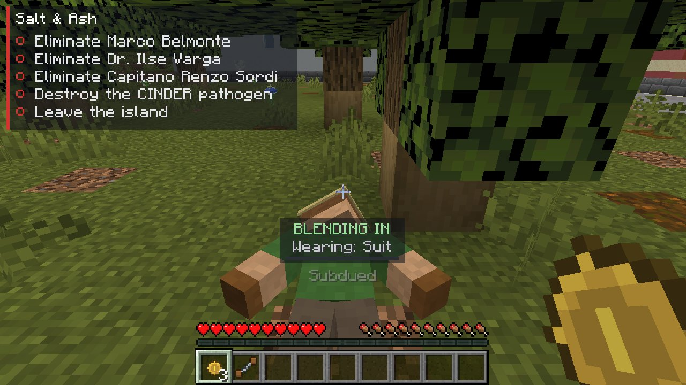 | 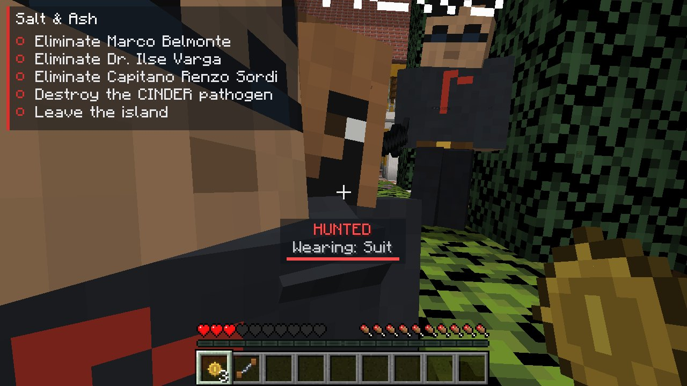 |

Not covered by automation: multiplayer with several real players, and playing the mission by hand from start
to finish. Guards hit hard, and balance (suspicion rates, vision ranges) has only been tuned by reasoning.

The headless self-test currently reports, for two minutes of simulated town life with all 131 NPCs:
703 waypoint arrivals and 0 NPCs stuck.

For Amsterdam (`-PselftestMission=amsterdam`) the self-test spawns the whole cast and the boats, lets the city run
for 90 seconds and then checks 32 things, among them: De Meester is hidden and left-handed and the wage book
identifies him; the clock moves Ostendorp onto her sale route at 19:45; the chandelier kills her at the lectern
and the hoist crate kills De Meester on the quay; a knife trips the metal detector and empty pockets don't; the
three boats are afloat with their skippers, the tour boats travel, Kooistra boards the *Zwaluw* and the
drawbridge opens for it; the bidder paddle opens the saleroom and the lever needs the bridge key; a rigged stove
catches the café cook; and Kooistra drowns when dropped in a canal.

## Roadmap

- Amsterdam: the four Recrafted Arsenal guns for the new roles, taking the *Zwaluw*'s wheel yourself, water taxis.
- More accident kills, more exits, a third contract.

## Licence

MIT, except the bundled Inter font subsets, which stay under the SIL Open Font License 1.1
(`src/main/resources/assets/recrafted/font/inter_license.txt`).
